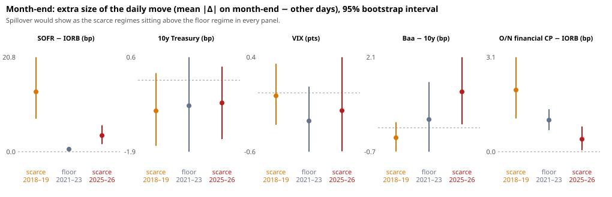

# Event study 01: result

**Exploratory.** Design: [`docs/design-event-study-01.md`](../../docs/design-event-study-01.md), written before the
first run, with two amendments made after it (listed there). Every figure below is read from
[`result.json`](result.json).

Inputs:

- the repo-market-model panel at commit `40fcc35`, SHA-256 `4ddc3882…a8999`, 3 Apr 2018 – 3 Sep 2026;
- FRED, retrieved 26 Oct 2026 ([`metadata/fred_manifest.json`](../../metadata/fred_manifest.json));
- 5,000 bootstrap draws, seed 20261026.

## In one line

Repo pressure on calendar days did **not** move Treasury yields, VIX, corporate credit, equities or the dollar more in
the scarce-reserve regimes than on the floor, at daily closes, in public data. Where it does show up is the nearest
ring of money markets, and there only weakly: bills and overnight unsecured CP.

## The repo shock is real (first stage)

The calendar delivers the dose the design relies on. Month-end change in SOFR − IORB, the event day minus other days,
as a difference from the floor regime:

| Regime vs floor 2021–23 | Month-end Δspread, extra (bp) | 95% interval |
|---|---:|---|
| scarce 2018–19 | +15.2 | [9.2, 22.5] |
| scarce 2025–26 | +5.0 | [3.0, 7.3] |

## The main test: is the market move larger when repo is scarce?

Difference in differences of the month-end size effect (mean |daily change| on month-end − other days), scarce minus
floor:

| Outcome | 2025–26 − floor | 2018–19 − floor (replication) |
|---|---|---|
| 10-year Treasury yield (bp) | +0.07 [−1.55, 1.63] | −0.14 [−1.70, 1.42] |
| VIX (points) | +0.11 [−0.48, 0.76] | +0.26 [−0.20, 0.72] |
| Baa − 10-year (bp) | +0.81 [−0.62, 2.19] | −0.54 [−1.74, 0.52] |
| Overnight financial CP − IORB (bp) | −0.64 [−1.15, −0.10] | +1.00 [−0.02, 2.15] |

None of the four shows a larger move in both scarce regimes. The one interval that excludes zero, CP in 2025–26, has the
wrong sign, and the replication points the other way.

## Secondary readings (not tests)

- **Multiplicity.** Across all market outcomes, events and regime contrasts, 8 of 144 difference-in-differences
  intervals exclude zero, against about 7 expected by chance. At the regime level, 33 of 252 exclude zero, against
  about 13. Most of these say calendar days are *quieter* than other days in every regime, which is likely because
  macro data releases fall on the baseline days. The difference in differences is built to net that out.
- **Overnight CP, signed.** On the floor, CP − IORB fell about 0.9 bp at month-end. In both scarce regimes it did not,
  so the signed difference in differences is +1.0 bp [0.3, 1.6] in 2025–26 and +1.1 bp [−0.5, 2.6] in 2018–19. This
  is consistent with month-end window dressing pulling unsecured rates down only when cash is plentiful. It is about
  1 bp, post hoc, and one of many comparisons.
- **Pass-through slopes** (daily market change per 1 bp daily spread change, all non-excluded days):
  - The 4-week bill − IORB moves with repo only in 2025–26: 0.14 [0.07, 0.23], against 0.01 in 2018–19 and −0.05 on
    the floor. Bills and repo share drivers (bill supply, TGA swings), so this is co-movement, not proof of causation.
  - Overnight CP moved with repo in 2018–19 (0.06 [0.01, 0.10]), not in 2025–26.
  - S&P 500 in 2025–26: +0.03% per bp [0.001, 0.058]. It is positive, borderline, and one of 32 slopes; read it as
    chance until it replicates.
- **Credit spreads in 2025–26 alone** (no floor comparison exists on FRED): on month-ends, IG OAS rose 0.8 bp more than on
  other days [0.05, 1.5] and HY 2.4 bp [−1.1, 6.0]. With no floor regime to difference against, this can't be told
  apart from a month-end pattern in index spreads.

## What this does and does not say about "impacting markets as a whole"

- **It says:** the calendar-driven repo pressure that came back in 2025–26 does not yet leave a detectable mark on
  daily closes of broad markets. If repo is moving wider markets, it is not through these predictable days, at this
  resolution, at a size that 20 month-ends can detect. A move of up to about 1.6 bp in the 10-year or 0.75 VIX points per
  month-end would still fit inside these intervals.
- **It does not rule out:**
  - **Effects inside the day**, which daily closes miss.
  - **Unscheduled stress.** This study looks at calendar days by design, but every post-2020 episode on the one-pager
    began within a day of a calendar date, and the tail days are too few to study separately.
  - **Markets FRED does not carry.** The links most likely to show it are swap spreads, the Treasury cash–futures basis
    (where leveraged funds finance in repo), the MOVE index and cross-currency basis.
- **What our data does show** is that exposure has grown. Dealer Treasury positions rose from about $131bn (2022
  average) to about $496bn (2026), and SOFR volume from about $1.0tn to $3.1tn a day, while the spread climbed toward
  zero. A repo shock now sits under far more leveraged Treasury positions than in 2018–19. That is the channel worth
  measuring next.

## Next, if wanted

1. Add the funding-sensitive markets: SOFR swap spreads, Treasury futures basis (CFTC leveraged-fund positioning is
   public, weekly), MOVE, and the EUR/USD and USD/JPY cross-currency basis. These need a source other than FRED.
2. Study the non-calendar tail (spread jumps ≥ 5 bp with no calendar cause), with a placebo on matched dates.
3. Test whether month-end effects on markets scale with the *size* of that month's repo shock, not just its regime,
   within 2025–26.
