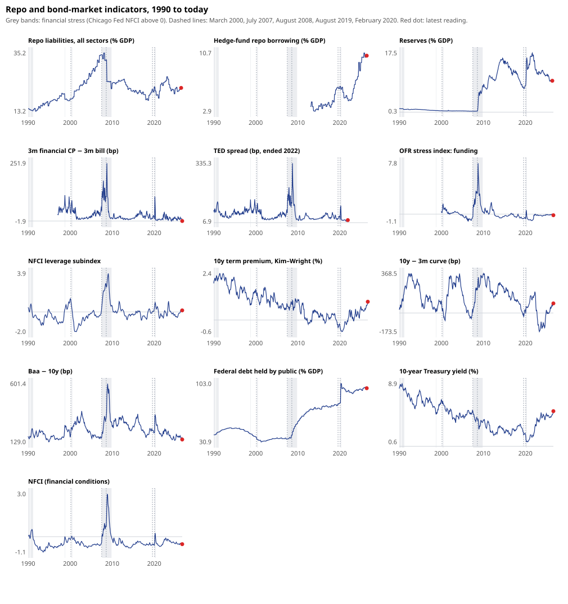

# Study 02: then and now — result

**Exploratory and descriptive.** Design: [`docs/design-study-02-then-and-now.md`](../../docs/design-study-02-then-and-now.md),
written before the first run. One check was added after the numbers were seen and is marked "post hoc". Every figure is
read from [`result.json`](result.json). The data is public (FRED, OFR), retrieved on 26 Oct 2026
([`metadata/long_manifest.json`](../../metadata/long_manifest.json)).

- **"Today"** is June 2026, the latest month every series covers (GDP and the Financial Accounts are quarterly).
- **"Latest"** is the latest complete month of each series, September 2026 for the daily ones.
- **Percentiles** are within each series' own history.

## In one line

Today does **not** look like the run-up to 2000 or 2007 on the measures that flashed then: funding stress, interbank
spreads, overall financial conditions. It looks different in three ways that history can't score, because they have
never been here before:

- leveraged funds' repo borrowing is at a record;
- public debt is at a record;
- credit spreads are as tight as they have been only once before, in the mid-1990s.

The 2007 run started in a corner that headline indicators missed. If there is a corner today, this is where it is.

## Then and now

| Indicator | Mar 2000 | Jul 2007 | Aug 2008 | Today (Jun 2026) | Latest |
|---|---|---|---|---|---|
| Repo liabilities, all sectors (% GDP) | 17.9 | 34.5 | 32.6 | 22.0 (p82) | same |
| Hedge-fund repo borrowing (% GDP) | – | – | – | **10.4 (p98)** | same |
| Reserves (% GDP)¹ | 0.4 | 0.3 | 0.3 | 9.3 | same |
| 3m financial CP − 3m bill (bp) | 33 | 42 | 104 | 10 | −0.1 (Sep) |
| TED spread (bp) | 50 | 54 | 108 | ended 2022 | |
| OFR stress index, funding | 0.23 | −0.40 | 3.15 | −0.08 (p56) | −0.17 |
| NFCI leverage subindex | 1.18 | 0.41 | 2.64 | 0.24 (p73) | 0.16 (p70) |
| NFCI, financial conditions | −0.13 | −0.37 | 0.74 | −0.51 (p37) | −0.53 |
| 10y term premium (%) | 1.40 | 0.79 | 0.83 | 0.75 | **0.96, highest since Apr 2010** |
| 10y − 3m curve (bp) | 39 | 4 | 213 | 66 | 90 |
| Baa − 10y (bp) | 211 | 165 | 326 | **153 (p8)** | **148 (p4)** |
| Federal debt held by public (% GDP) | 36.9 | 34.7 | 39.0 | **97.4 (p98)** | same |
| 10-year yield (%) | 6.26 | 5.00 | 3.89 | 4.47 | **4.99, highest since Jul 2007** |

¹ Before late 2008 reserves earned no interest and were kept near zero. The level is not comparable across that break.

## Would it have warned?

For each indicator with a warning direction set in the design: of the months since 1990 that were at least as extreme
as today, the share followed by a stress onset within 24 months. A stress onset is the NFCI rising above 0 after six
calm months. Since 1990 that happened in Oct 1998 (LTCM), May 2000, Aug 2007 and Mar 2020. Only months up to Sep 2024
count, since later months' 24-month windows are not yet observed. In those months, 21.8% of all months were followed
by an onset.

| Indicator | Months as extreme as today | Followed by stress | vs all months |
|---|---:|---:|---|
| 10y − 3m curve (as low as today) | 112 | 48% | higher, the only clear one |
| 3m financial CP − bill (as high) | 252 | 33% | slightly higher |
| NFCI leverage (as high) | 90 | 28% | slightly higher |
| Reserves/GDP (as low)¹ | 271 | 31% | not meaningful: mostly the pre-2008 regime |
| Repo/GDP (as high) | 165 | 16% | lower |
| Baa − 10y (as wide) | 390 | 21% | the same |
| OFR funding stress (as high) | 134 | 4% | lower |
| Hedge-fund repo/GDP, debt/GDP (as high) | 0 and 6 | – | **no history at today's level** |
| *Post hoc:* Baa − 10y (as **tight** as today) | 27 | 37% | higher, but every hit is 1996–97, ahead of LTCM |

**Reading:** of the indicators with a track record, none flashes a strong warning today. The curve has the best
record, but today's 66–90 bp is not an inversion. It is the range the curve passes through after one, and the 2022–24
inversion has so far been followed by no NFCI stress onset. With four onsets since 1990 these shares are anecdotes
with a denominator. They can show an indicator failing to warn, not one working.

## What is new this time

1. **Who holds the leverage.** Total repo is well below its 2007 peak: 22% of GDP against 35% in January 2008. But
   leveraged funds' repo borrowing has tripled, from 3.6% of GDP in 2013 to 10.4% today, and it peaked at 10.7% in
   October 2025. In 2007 the leverage was dealer balance sheets financing private asset-backed collateral. Today a
   large share is hedge funds financing Treasuries, typically in relative-value and basis trades. Form PF gross repo
   and the Financial Accounts' repo liabilities are measured differently, so the two shares are not a strict ratio.
2. **The collateral is the bond market itself.** Federal debt held by the public is 97% of GDP, against 35% before
   2007. The 10-year yield's September average was the highest since July 2007, and the term premium is the highest
   since 2010: investors are asking more to hold duration. In this setup a bond-market shock and a repo shock are the
   same shock. Study 01's probe hint that big Treasury moves now feed repo pressure the next day fits that, but has
   not been tested.
3. **Risk is priced as if none of this matters.** At 148 bp, Baa − 10y is tighter than before the 2007 run (165 bp)
   and as tight as only in 1994–97. Overall conditions are loose (NFCI −0.53) and funding calm (CP − bill about 0).
   Before 2007 this combination meant complacency, but the spreads alone didn't call the timing.
4. **Plumbing changes are scheduled.** QT ended on 1 Dec 2025 and the Fed now buys bills to keep reserves ample. The
   Standing Repo Facility set a record of $74.6bn on 31 Dec 2025. Treasury central clearing becomes mandatory for cash
   trades on 31 Dec 2026 and for repo on 30 Jun 2027: the largest change to the repo market's structure since 2008,
   landing on the most leveraged part of it.

## What would actually test "a crisis is coming"

These steps would turn this from resemblance into evidence:

1. **The basis-trade size**, from CFTC positioning (leveraged funds' Treasury futures shorts). It needs
   `publicreporting.cftc.gov` and `www.cftc.gov`. Is it at a record, and did it shrink in April 2025?
2. **Whether market stress now feeds repo**, and more so as hedge-fund repo grew: study 01's hint, tested under its
   own design, with the April 2025 and March 2020 episodes as the cases to explain.
3. **Who lends the cash.** Money-fund repo by counterparty (SEC N-MFP, needs `www.sec.gov`). If funds' cash is
   concentrated in sponsored and hedge-fund repo, a run starts where it did in 2008: with the lenders.
4. **What clearing changes.** Whether sponsored repo volumes and haircuts move as the 2026–27 deadlines near.

## Limits

- **Three crises, many indicators.** No indicator here has an established track record, and these indicators were
  chosen knowing 2008.
- **The record omits the market that would matter most.** It has nothing on bilateral repo haircuts, swap spreads,
  the futures basis or intraday Treasury liquidity.
- **Revisions.** GDP, the Financial Accounts and FRED's latest vintages revise. Today's ratios use June 2026 GDP as
  published in October 2026.
