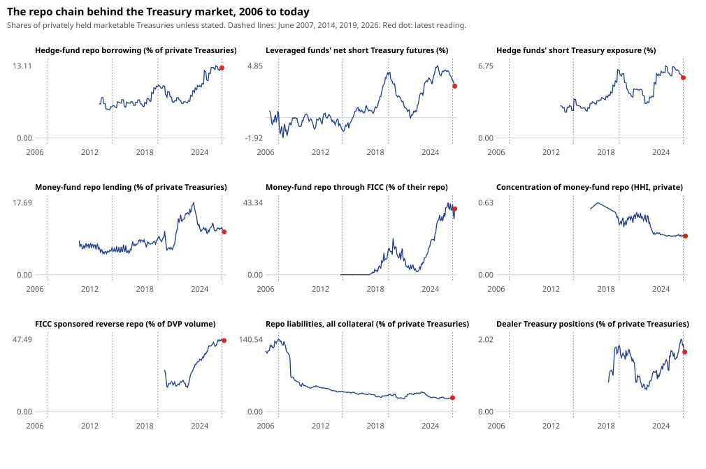

# Study 03: map of the chain (H1) — result

Design: [`docs/design-study-03-chain.md`](../../docs/design-study-03-chain.md), written before the first run. Every
figure is read from [`result.json`](result.json). Data: FRED, Treasury (Monthly Statement of the Public Debt), OFR,
CFTC, retrieved 26 Oct 2026 ([`metadata/chain_manifest.json`](../../metadata/chain_manifest.json)).

The yardstick is **privately held marketable Treasuries**: marketable debt held by the public minus the Fed's
holdings. It was $3.5tn in June 2007, $13.8tn in June 2019 and $26.6tn in June 2026.

## Verdict: H1 not supported, by the rule fixed in advance

| Criterion | Measure | Jun 2019 | Jun 2026 | Percentile | Passes? |
|---|---|---:|---:|---:|---|
| (a) size | M2 hedge-fund repo borrowing, % of private Treasuries | 9.35 | **12.72** | 94 | yes |
| (a) size | M4 leveraged funds' net short Treasury futures, % | 4.04 | 3.46 | 84 | **no**: below 2019, not top decile |
| (b) concentration | C1 FICC's share of money-fund repo (%) | 15.7 | **42.3** | 99 | yes |
| (b) concentration | C2 HHI of money-fund repo across private counterparty types | 0.44 | 0.34 | 27 | **no**: fell |

Each criterion needed both of its measures, so neither (a) nor (b) holds, and H1 is not supported as specified. Each
criterion is half-met, which the rule did not count as "partly". The result is reported as the rule gives it.

## What the measures show

**Hedge funds borrow more in repo than ever, relative to the market.**
- Their repo borrowing went from $1.29tn (2019) to $3.38tn (Jun 2026), from 9.4% to 12.7% of private Treasuries.
- It peaked at 13.1% in October 2025.
- It grew faster than the Treasury market, which itself almost doubled.

**The basis-trade proxy is *not* at a record and is shrinking.**
- Leveraged funds' net short in Treasury futures peaked at 4.85% of private Treasuries ($1.15tn) in October 2024.
- It was 3.46% in June 2026 and 2.94% ($0.80tn) by September 2026.
- It did not shrink during April 2025: the weekly short grew through that month.
- So hedge funds' repo borrowing stayed at its record while their futures short fell. Their repo now funds more than
  the classic cash–futures basis. Other relative-value trades, such as swap spreads, or outright long positions are
  candidates, but public data cannot say which.

**The cash comes increasingly through one channel.**
- Money funds' repo lending through FICC's sponsored service went from 0% (2014) to 15.7% (2019) to 42.3% (Jun 2026),
  $1.30tn, and was 39.6% by September 2026.
- FICC sponsored reverse repo was 46.7% of cleared DVP repo volume in June 2026 (FICC's own label). It has
  risen steadily since 2021 (chart).

**Spread across *types* of lending counterparty, money-fund repo is less concentrated than in 2019.**
- In 2019, foreign banks took 57% of money funds' repo. Now it is split between FICC (42%), domestic institutions
  (27%) and foreign institutions (30%), so the Herfindahl index fell.
- The pre-registered measure (C2) counted FICC as one type among four. But FICC is a single node: a central
  counterparty standing between many borrowers and lenders.
- *Post hoc reading:* the Herfindahl index across types answers "is the lending spread across kinds of borrower?",
  and the answer is yes. It does not answer "does the cash depend on one piece of infrastructure?". By C1, it
  increasingly does. That reading came after the result and decides nothing here. Study 06 can test it properly.

**Context measures:**
- **Dealer Treasury positions:** 1.87% of private Treasuries in June 2026, as in 2019 (1.85%). Dealers grew with the
  market, not faster.
- **All-collateral repo:** fell from 141% of private Treasuries in 2007 to 27%. 2007's repo was mostly against
  non-Treasury collateral, so this is not a Treasury-only comparison. It does say that repo is a smaller part of the
  financial system than before 2008.
- **Money-fund repo:** 11.6% of private Treasuries in June 2026, below its May 2023 peak (17.7%). In those years most
  of it went to the Fed's RRP, whose share of money-fund repo peaked at 80.9% in September 2022.

## What this means for the question

The chain is real: hedge-fund repo borrowing at a record relative to the market, and money-fund cash flowing to it
increasingly through FICC. But two parts of "concentrated and growing to a record" did not hold up:
- the measurable basis trade is smaller relative to the market than in 2019, and has shrunk since 2024;
- across lender types, the cash is more diversified than in 2019.

A crisis story built on "the basis trade is at a record" would not survive these numbers. One built on "hedge-fund
repo is at a record, and the cash behind it runs through one clearing node, months before mandatory clearing" is
consistent with them, but it is a description, not a test. Studies 04 and 06 are where it gets tested.

## Limits

- **Form PF** is quarterly, lagged and limited to qualifying hedge funds. Repo borrowing there includes non-Treasury
  collateral.
- **M4** counts futures face value, not duration-weighted risk, and not every short is a basis position.
- **C2** has a straight segment in 2016–17 where the "other counterparties" series has gaps.
- **No 2007 comparison** exists for the Treasury-specific measures, which start in 2013–20.
